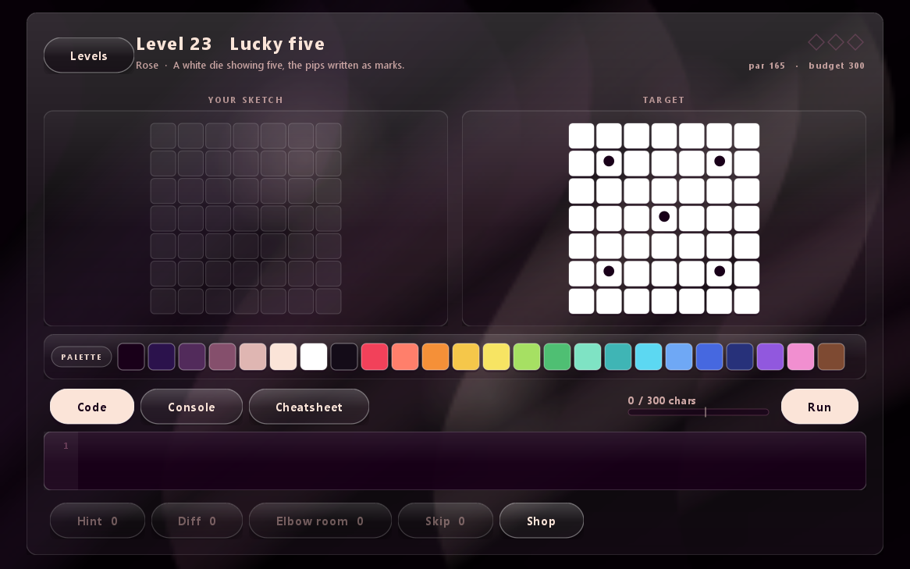
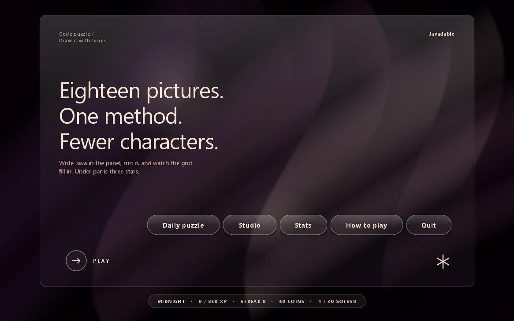
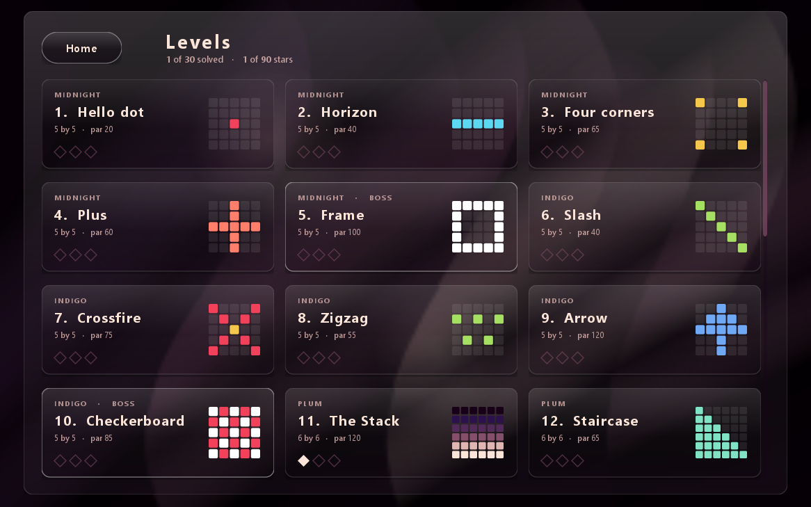
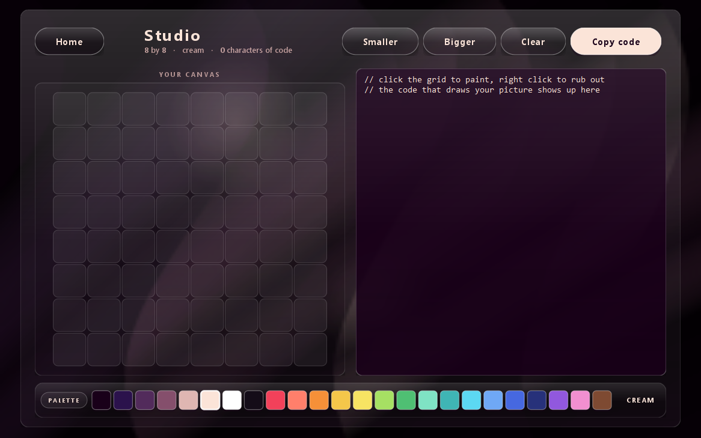

# Javadable

A code-golf puzzle game for the desktop. Every level shows a target picture; you write Java
that paints the same picture on the grid, in as few characters as you can. Your code is
compiled live by the JDK compiler while you play.

Thirty levels in six chapters, a palette of 24 colours and a set of marks and emoji you can
write on the cells, a free-draw Studio that turns your drawing back into code, daily puzzles
with a streak, stars, coins and badges. Pure Java Swing, no dependencies.

Double click `Javadable.bat` to play. A JDK is required, not just a JRE.

The rest of this file is in Bulgarian.

| | |
|---|---|
|  |  |

Пъзел игра с код в духа на pydle, но на Java, с тъмен стъклен (glassmorphism) интерфейс
върху почти черен фон с бавно движещи се копринени гънки.

Всяко ниво показва картинка вдясно. Ти пишеш код вляво, натискаш **Run**, и ако твоята мрежа
стане същата като целевата — нивото е решено. Броят на символите има значение: под par са три
звезди, в рамките на бюджета са две.

## Пускане

Двоен клик на **Javadable.bat**.

Трябва JDK (не само JRE), защото играта компилира твоя код наживо, докато играеш.
Инсталираният е Eclipse Temurin 21. Скриптът го намира сам; ако имаш друг, сложи `JAVA_HOME`.

Проверка дали всичко е наред:

    java -jar build\javadable.jar --selftest

## Как се пише

Редакторът е тялото на метод `draw()`, тоест пишеш обикновена Java — цикли, условия, масиви, `Math`.
Целият език за рисуване е един метод:

    p(x, y, "red");              // оцветява една клетка
    p(x, y, "sky", "J");         // клетка с надпис върху нея
    in(x, y)                     // вярно, ако клетката съществува
    print(нещо)                  // ред в таба Console
    W, H                         // ширина и височина на нивото

**Ctrl + Enter** пуска кода, **Escape** се връща към нивата.

## Палитрата и знаците

Под мрежите стои лентата с всички 24 цвята. Клик върху цвят го пише в кода на мястото на курсора,
така че не се налага да помниш имената. Бутонът PALETTE вляво обръща лентата към знаците:
звезди, сърца, точки и шепа емоджи, които влизат като четвърти аргумент на p и се рисуват
върху клетката. Цветовете са:

ink, deep, plum, mauve, rose, cream, white, black, red, coral, orange, gold, yellow, lime,
green, mint, teal, cyan, sky, blue, navy, purple, pink, brown.

## Studio

Отделен режим за свободно рисуване. Избираш цвят от палитрата, рисуваш с мишката
(десен бутон трие), а играта пише кода, който би нарисувал същото — с цикли, където има
поредица от еднакви клетки. Бутонът **Copy code** го слага в клипборда.

## Нивата

30 нива в шест глави по пет, кръстени на цветовете: Midnight, Indigo, Plum, Mauve,
Rose, Cream. Последното ниво на всяка глава е бос. Мрежата расте от 5x5 до 9x9, а
картинките са точка, хоризонт, ъгли, кръст, рамка, диагонал, X, зигзаг, стрелка,
шахматна дъска, палитрата, стълба, райета, усмивка, пръстени, диамант, дърво, къща,
дух, нашественик от аркадата, надпис JAVA, вълна, зар, дъга, триъгълник на Сиерпински,
мишена, цвете, котка, лабиринт и мандала.

## Бюджетът

Броят се само символите, които не са празно място, и коментарите не се броят. Подреждай кода
както ти е удобно — отстъпите и новите редове са безплатни.

## Помощници

С монети от решени нива се купуват четири неща: **Hint** казва правилото зад картинката,
**Diff** огражда клетките, които още не съвпадат, **Elbow room** добавя 50 символа към бюджета,
**Skip** отключва следващото ниво без да решаваш това.

## Дневен пъзел и стрийк

Дневният пъзел е един и същ за целия ден. Решавай по един на ден, за да расте стрийкът.

## Къде се пази прогресът

`C:\Users\<ти>\.javadable\profile.json` — звезди, най-добри бройки символи, монети, значки
и кодът, който си оставил на всяко ниво. Изтриеш ли файла, започваш начисто.

## Пресглобяване

Двоен клик на **build.bat**.
