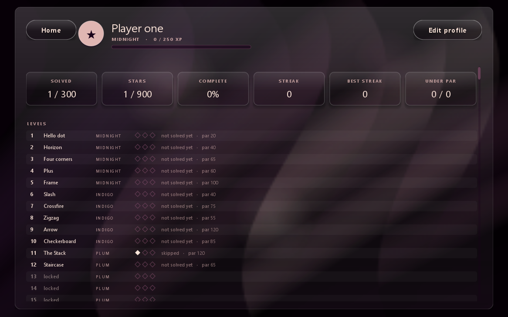

# Javadable

A code golf puzzle game for the desktop. Every level shows a target picture; you write Java
that paints the same picture on the grid, in as few characters as you can. Your code is
compiled live by the JDK compiler while you play.

**[The game has a page of its own.](https://mihaelakrt.github.io/javadable-game/)**
300 levels, a new generated puzzle every day, 24 colours, marks and emoji, a drawing Studio
that writes your code for you, and a profile that keeps the lot.


## Playing

Double click `Javadable.bat`, or run the jar from the
[latest release](https://github.com/mihaelakrt/javadable-game/releases/latest):

    java -jar javadable-1.1.jar

A **JDK** is required, not just a JRE, because the game compiles your code while it runs.
Eclipse Temurin 21 is a good choice. `Javadable.bat` finds a JDK on its own, or set `JAVA_HOME`.

Check that everything is in place:

    java -jar javadable-1.1.jar --selftest

## Writing a sketch

The editor holds the body of a `draw()` method, so you write ordinary Java: loops, conditions,
arrays, `Math`, whatever you like. The whole drawing language is one method:

```java
p(x, y, "red");           // paint one cell
p(x, y, "sky", "J");      // paint a cell and write a mark on it
in(x, y)                  // true when the cell is on the grid
print(anything)           // a line in the Console tab
W, H                      // the width and height of this level
```

The second level, a cyan line across the middle, is this:

```java
for (int x = 0; x < W; x++) {
    p(x, 2, "cyan");
}
```

**Ctrl and Enter** runs the sketch, **Escape** goes back to the levels.

## The budget

Only characters that are not whitespace count, and comments do not count at all, so lay the
code out however you like. Finish under par for three stars, inside the budget for two, and
anything that matches the picture keeps one.

## The palette

The bar under the grids holds all 24 colours: ink, deep, plum, mauve, rose, cream, white,
black, red, coral, orange, gold, yellow, lime, green, mint, teal, cyan, sky, blue, navy,
purple, pink, brown. Click one and it is written into your code at the caret.

Click **PALETTE** on the left of that bar and it flips over to the marks: stars, hearts, dots,
and a dozen emoji. A mark is the fourth argument of `p`, and it is drawn on top of the cell.


## Levels

**300 levels in 33 chapters.** The first thirty are drawn by hand: a dot, a horizon, four
corners, a plus, a frame, a diagonal, a cross, a zigzag, an arrow, a checkerboard, the palette
itself, a staircase, stripes, a smiley, rings, a diamond, a tree, a house, a ghost, an arcade
invader, the word JAVA, a wave, a die, a rainbow, a Sierpinski triangle, a bullseye, a flower,
a cat, a labyrinth and a mandala. The last level of every chapter is a boss.

The other 270 are generated. Each pattern family (rings, bullseyes, blocks, chevrons, stripes,
diamonds, discs, crosses, saltires, steps, frames, weaves, dots and symmetric signs) is produced
twice: once as the picture to aim at and once as the code that draws it. The budget is measured
from that reference solution, so par is never guesswork, and every level is known to be
solvable before you see it. The grids grow from 5x5 to 12x12 as the tiers climb.

## The daily puzzle

Every day the generator makes up a puzzle from the date alone: the same picture for everyone
playing that day, and one nobody has played before. Solving it moves your streak along.


## Studio

A free drawing mode. Pick a colour and a mark, draw on the grid with the mouse (right click
rubs out), resize the canvas from 4x4 to 14x14, and the game writes the code that would draw
the same picture, folding runs of equal cells into loops. **Copy code** puts it on the clipboard.


## Profile

Your name, a badge of your own colour and mark, your rank and experience, and a line for every
level with its stars, your best character count and how it sits against par. Twelve badges to
collect, a daily puzzle with a streak, coins and four helpers: **Hint** spells out the rule
behind the picture, **Diff** outlines the cells that are still wrong, **Elbow room** adds fifty
characters to the budget and **Skip** opens the next level.



## Where the progress is kept

`C:\Users\<you>\.javadable\profile.json` holds the stars, the best character counts, the coins,
the badges and the code you left on every level. Delete it to start over.

## Building

Double click `build.bat`, which compiles `src` into `build/classes` and packs
`build/javadable.jar`. Nothing but a JDK is needed; there are no dependencies.

## How it works

`javadable.core.Runner` wraps what you typed in a class, compiles it in memory with
`javax.tools.JavaCompiler`, loads it with a small class loader and runs `draw()` on a daemon
thread with a two and a half second limit. The picture you paint is a `javadable.core.Canvas`,
which is compared with the level's own canvas cell by cell. Everything on screen is drawn by
hand with Java2D: the drifting backdrop, the frosted glass, the tiles and the typography.

## Licence

MIT, see [LICENSE](LICENSE).
